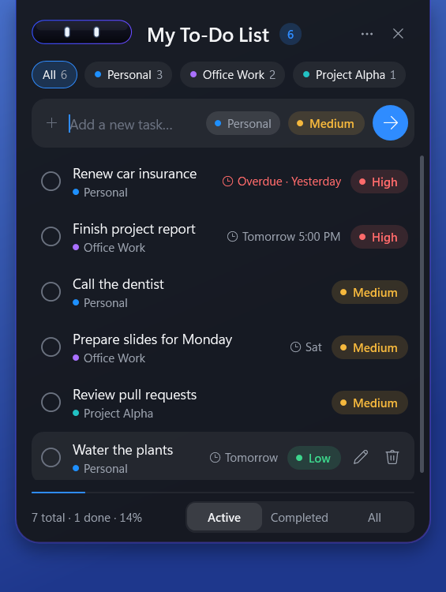
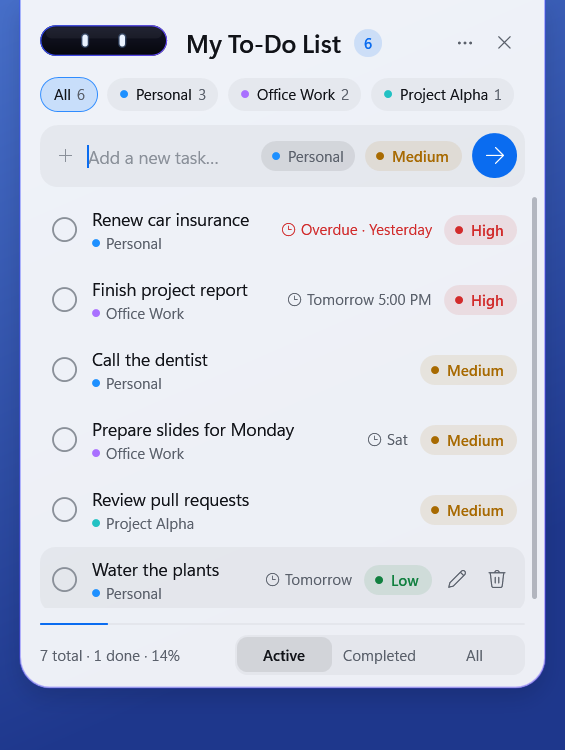
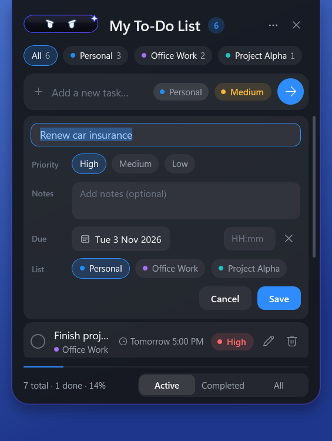
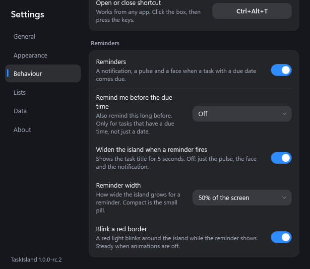
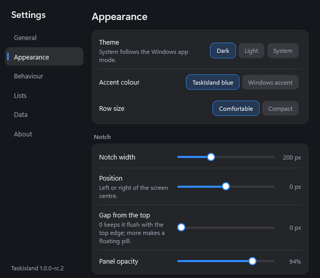

# TaskIsland

A Dynamic Island-style to-do list for Windows 11, by **RieSources** (https://rie-sources.com).

A small notch with a friendly face sits at the top centre of your screen. Click it and it stretches into a full to-do
list: add, edit, tick and prioritise tasks, sort them into lists, set due dates and get reminders. Click away and it
folds back into the notch. It runs quietly from the system tray, starts with Windows and comes back after sleep. All
data stays on your PC; the app makes no network connections.

<p align="center">
  
  
</p>

<p align="center">
  <br>
  <em>Resting: the notch at the top of the screen. It blinks, looks around and reacts to what you do.</em>
</p>

<p align="center">
  <br>
  <em>A reminder: the island grows to half the screen width with a blinking red border, plus a Windows notification.</em>
</p>

## Contents

- [Download](#download)
- [Install](#install)
- [How to use](#how-to-use)
- [Settings](#settings)
- [Your data](#your-data)
- [Uninstall](#uninstall)
- [Troubleshooting](#troubleshooting)
- [Status and known limits](#status-and-known-limits)
- [Build from source](#build-from-source)

## Download

Latest test release **1.0.0-rc.2** on the [Releases page](https://github.com/Riekie3/Dynamic-Island-To-Do-List/releases):

| File | What it is |
|---|---|
| `TaskIsland-Setup-1.0.0-rc.2-x64.exe` | **Installer (recommended).** Installs for your Windows user only. No administrator rights, no UAC prompt. |
| `TaskIsland-1.0.0-rc.2-win-x64-portable.zip` | **Portable.** Unzip and run; nothing is installed. |

Requirements: Windows 11 (or Windows 10 version 1809 or newer), 64-bit. Nothing else: the .NET runtime is included.

**Check the files yourself.** Both files were scanned on VirusTotal, and you can compare their SHA-256 hashes (also in
the [release notes](docs/RELEASE_NOTES.md)):

| File | SHA-256 | VirusTotal |
|---|---|---|
| `TaskIsland-Setup-1.0.0-rc.2-x64.exe` | `E3CE55F9137A4A019E42BEE2241E837DC53D5CF6BFB6808CD734E30929B771C1` | [scan report](https://www.virustotal.com/gui/file/e3ce55f9137a4a019e42bee2241e837dc53d5cf6bfb6808cd734e30929b771c1) |
| `TaskIsland-1.0.0-rc.2-win-x64-portable.zip` | `8ACE638D1D6BE2010B817149A21C9D1C7E183893E9DE883800D1C96A108FB5EA` | [scan report](https://www.virustotal.com/gui/file/8ace638d1d6be2010b817149a21c9d1c7e183893e9de883800d1c96a108fb5ea) |

In PowerShell: `Get-FileHash .\TaskIsland-Setup-1.0.0-rc.2-x64.exe` shows the hash of your download.

### About the one VirusTotal detection (installer)

On VirusTotal the installer is flagged by **1 of 68** security vendors: **Deep Instinct**, which reports only
"MALICIOUS" with no malware name. The other 67 engines report it clean, and so does **Microsoft Defender** (scanned
locally with up-to-date signatures, no threats found). We believe this is a **false positive**:

- Deep Instinct is a *machine-learning* scanner. It judges how a file *looks* (its structure, how new it is, whether it
  is signed), not what it does, and it has no named signature for TaskIsland. A brand-new program from a one-person
  developer that is **not code-signed** and ships as a setup program is exactly what such models often get wrong.
- Setup programs made with Inno Setup (like this one) bundle everything into one self-extracting file, which also looks
  unusual to a classifier, even though it is the standard way to package Windows apps.
- TaskIsland does none of the things real malware needs: it makes **no network connections**, installs **no hooks**, starts
  **no other programs**, needs **no administrator rights** and writes only to your own user folders. The complete source
  code is in this repository, and you can build the same installer yourself (see [Build from source](#build-from-source)).

If you would rather not take our word for it: compare the SHA-256 hash above, scan the file with your own antivirus,
or use the **portable zip** and the source code. The detection has been reported to the vendor as a false positive;
such flags usually disappear within days. The rc.2 files are unsigned on purpose for now (code signing is a paid
certificate), which is also why Windows SmartScreen shows its warning.

## Install

### Installer

1. Download `TaskIsland-Setup-1.0.0-rc.2-x64.exe` and run it.
2. The files are **not code-signed** yet, so Windows SmartScreen may show "Windows protected your PC". Click
   **More info**, then **Run anyway**. (If Smart App Control is turned on, Windows may block unsigned apps entirely.)
3. Click through the installer. It installs to `%LocalAppData%\Programs\TaskIsland`, adds TaskIsland to the Start
   menu (a desktop icon is optional) and starts it at the end.
4. The notch appears at the top centre of your screen and a tray icon is added near the clock.

**Upgrading:** run a newer installer over the top. Your tasks and settings stay. If TaskIsland is running, the
installer asks you to close it first (tray icon > **Exit**).

**Coming from the portable rc.1?** Exit it from the tray first, then install. The installed copy finds the same tasks
(the data folder is shared) and takes over "Start with Windows" on its first start. You can then delete the old
portable folder.

### Portable

1. Unzip `TaskIsland-1.0.0-rc.2-win-x64-portable.zip` to a folder you keep, for example `Documents\TaskIsland`.
2. Double-click `TaskIsland.exe` (same SmartScreen note as above).
3. "Start with Windows" is on by default and points at that folder, so do not move the folder afterwards.

## How to use

### The notch

| Do this | What happens |
|---|---|
| **Click** the notch | It opens into the to-do panel. |
| **Hover** over it | It shows how many tasks are left; hover a little longer to peek at your next task. |
| **Ctrl+Alt+T** (from any app) | Opens or closes the panel. You can change the shortcut in Settings. |
| Click outside, press **Esc** or click **✕** | The panel folds back into the notch. |

<p align="center">
  
  <br>
  <em>Left: the face reacts, for example it smiles when you tick a task. Right: hover to peek at the next task.</em>
</p>

### Tasks

- **Add:** type in "Add a new task…" and press **Enter** (or click the blue arrow). The chips next to the box choose the
  list and the priority (click the priority chip to cycle High / Medium / Low). The box stays focused, so you can add
  several in a row.
- **Tick:** click the circle. Ticked tasks stay for 2 seconds, then slide away into **Completed**.
- **Edit:** hover a task and click the pencil (or select it and press **F2**) to change its title, priority, notes, due
  date and time, and list. **Save** or **Cancel**.
- **Delete:** hover a task and click the bin (or press **Delete**). An **Undo** bar appears for a few seconds.
- **Reorder:** drag a task up or down, or select it and press **Alt+Up** / **Alt+Down**.
- **Filter:** **Active**, **Completed** or **All** at the bottom. The bottom line shows totals and progress.
- **Clear completed:** the **…** menu at the top right.

<p align="center">
  <br>
  <em>Editing a task.</em>
</p>

### Lists

- The chips under the title switch lists: **All**, **Personal**, **Office Work** and any you create. Each shows how
  many tasks are left.
- **＋** at the end of the chips creates a list (name and colour). **Right-click** a chip to rename it, change its
  colour, move it left or right, or delete it. The same is in Settings > **Lists**.
- **Ctrl+1…9** jumps to list 1-9, **Ctrl+0** to All, **Ctrl+Tab** / **Ctrl+Shift+Tab** to the next or previous list.

### Due dates and reminders

- Give a task a due date (and optionally a time) in the edit form. Overdue tasks show in red.
- When a task comes due, TaskIsland shows a Windows notification and the island grows across the screen with the task
  title and a blinking red border for 5 seconds. Hover keeps it open; **click it** to open that task's list.
- Optional early reminder ("Remind me before the due time": 5 minutes up to 1 day) in Settings > Behaviour.
- Tasks that came due while the PC was off are shown together on the next start.

### Tray icon

Left-click opens or closes the panel. Right-click for **Open TaskIsland**, **Expand / Collapse**, **Hide / Show** (the
notch), **Pause visibility**, **Settings…** and **Exit**.

## Settings

Open them from the tray icon (right-click > **Settings…**) or from the panel's **…** menu.

| Page | What you can change |
|---|---|
| **General** | Start with Windows, open expanded at start, collapse when clicking outside, collapse with Esc, always show the notch (off: it tucks into a thin sliver until you point at it). |
| **Appearance** | Theme (Dark, Light, System), accent colour, row size, notch width and position, gap from the top, panel opacity, the mascot face, how often it pops up, companion, animations. |
| **Behaviour** | Which display, hide in full-screen apps, collapse by itself, come back after sleep, peek on hover, slide out ticked tasks, the open/close shortcut, and **Reminders**: on/off, early reminder, widen the island, **reminder width** (Compact, 30-75 % of the screen or full width) and **blink a red border**. |
| **Lists** | Your lists, where new tasks go (default list), what the notch counts. |
| **Data** | Daily backup, export and import (JSON), back up now, restore a backup, open the data folder, clear completed tasks. |
| **About** | Version and credits. |

<p align="center">
  
  
</p>

## Your data

- Everything is stored on your PC in `%LocalAppData%\TaskIsland`: the database (`Data`), daily backups (`Backups`, the
  last 7 are kept) and log files (`Logs`).
- Settings > **Data** exports everything to a JSON file and imports it again (merge or replace), for example to move to
  another PC.
- TaskIsland never connects to the internet.

## Uninstall

- **Installed:** Windows **Settings > Apps > Installed apps > TaskIsland > Uninstall**. It removes the program, the
  Start menu entry and "Start with Windows", then asks **"Also delete your tasks and backups?"**. **No** (the default)
  keeps them, so a later install finds them again. **Yes** deletes `%LocalAppData%\TaskIsland`.
- **Portable:** Settings > General, turn off **Start with Windows**; tray icon > **Exit**; delete the folder. To also
  delete your tasks, delete `%LocalAppData%\TaskIsland`.

## Troubleshooting

| Problem | Try this |
|---|---|
| "Windows protected your PC" | **More info** > **Run anyway**. The app is not code-signed yet. |
| An antivirus flags the installer | See [About the one VirusTotal detection](#about-the-one-virustotal-detection-installer). Compare the SHA-256 hash, or use the portable zip. |
| The notch is gone | Tray icon > **Show** or **Resume visibility**. It also hides on purpose during full-screen videos, games and slide shows. |
| Ctrl+Alt+T does nothing | Another app may use it: Settings > Behaviour shows a warning; pick another shortcut. |
| The notch is on the wrong screen | Settings > Behaviour > **Show on display**. |
| Something else | Look in `%LocalAppData%\TaskIsland\Logs` and open an issue with the last lines of the newest log. |

## Status and known limits

**1.0.0-rc.2 is a test release.** 1.0.0 follows after some days of real use. Details:
[docs/RELEASE_NOTES.md](docs/RELEASE_NOTES.md).

- Memory is above the original target: about 64 MB private (130-140 MB working set once the panel has been opened).
  WPF itself needs much of that.
- The face's random animations cost a little CPU: about 1.5-2 % of one core averaged over the first minutes after a
  first start in our latest check (lower over long idle periods; "Face pops up on its own" can be turned down).
- Sleep, hibernate, reboot auto-start, multiple monitors and display scaling are being verified in real use.
- Not code-signed (by choice), so SmartScreen warns on first run.
- Licence: [MIT](LICENSE). Free to use, copy and modify.

Project documents: [PLAN](docs/PLAN.md) (design and build guide), [TESTING](docs/TESTING.md) (test checklist with
results), [DEVLOG](docs/DEVLOG.md) (what was built when, with measurements).

## Build from source

Needs the .NET 10 SDK (and Inno Setup 6 for the installer). `nuget.config` points at nuget.org only.

```
dotnet build TaskIsland.sln
dotnet test
powershell -File tools\publish.ps1           # portable folder + zip in the publish folder
powershell -File tools\build-installer.ps1   # installer in installer\Output (needs Inno Setup 6)
```

Tech: C# · .NET 10 · WPF (MVVM) · SQLite · Windows 11 x64. Screenshots: `tools\ui-tests\readme_shots.ps1`.

---

Developed by **RieSources** · https://rie-sources.com
