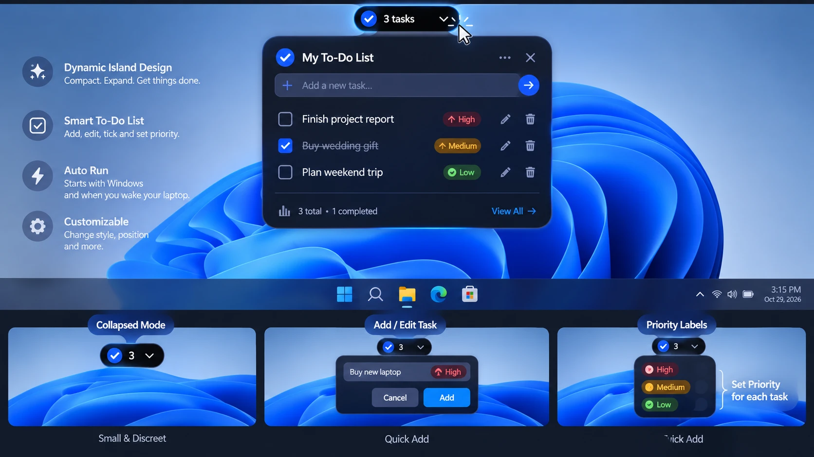

# TaskIsland

A Dynamic Island-style floating To-Do List for Windows 11.

A small black pill sits at the top centre of your screen showing how many tasks are left.
Click it and it stretches down into a full To-Do list — add, edit, tick and prioritise tasks,
then it folds back into the pill. Runs quietly from the system tray, starts with Windows and
survives sleep / wake. Organise tasks into lists such as Office Work, Personal or per-project. All data stays on your PC (SQLite in `%LocalAppData%\TaskIsland`).



## Status

🚧 Planning complete, development not started. See [docs/PLAN.md](docs/PLAN.md) (build guide), [docs/TESTING.md](docs/TESTING.md) and [docs/DEVLOG.md](docs/DEVLOG.md).

## Tech

C# · .NET 10 · WPF (MVVM) · SQLite · Windows 11 x64

## Build (developers)

```
dotnet build TaskIsland.sln
dotnet test
```
