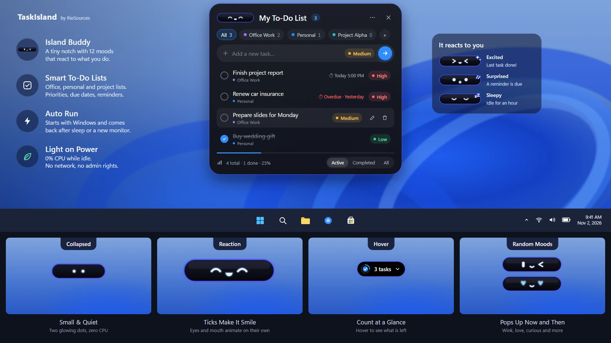

# TaskIsland

A Dynamic Island-style floating To-Do List for Windows 11.

A small black pill sits at the top centre of your screen showing how many tasks are left.
Click it and it stretches down into a full To-Do list — add, edit, tick and prioritise tasks,
then it folds back into the pill. Runs quietly from the system tray, starts with Windows and
survives sleep / wake. Organise tasks into lists such as Office Work, Personal or per-project. All data stays on your PC (SQLite in `%LocalAppData%\TaskIsland`).



## Download (portable test release)

Get `TaskIsland-1.0.0-rc.1-win-x64-portable.zip` from the
[Releases page](https://github.com/Riekie3/Dynamic-Island-To-Do-List/releases), unzip it somewhere permanent and run
`TaskIsland.exe`. No installer, no administrator rights, no .NET install needed. The file is not code-signed, so
Windows SmartScreen may warn: click **More info**, then **Run anyway**. An installer follows after a few days of testing.
See [docs/RELEASE_NOTES.md](docs/RELEASE_NOTES.md) for what is known to be rough.

## Status

Phases 1-7 are done for the portable build (database, island interface, to-do features, Windows integration, Settings,
testing and optimisation, publish). The installer and the user's own sleep/hibernate/multi-monitor tests are still open.
See [docs/PLAN.md](docs/PLAN.md) (build guide), [docs/TESTING.md](docs/TESTING.md) and [docs/DEVLOG.md](docs/DEVLOG.md).

## Tech

C# · .NET 10 · WPF (MVVM) · SQLite · Windows 11 x64

## Build (developers)

Needs the .NET 10 SDK. `nuget.config` points at nuget.org only.

```
dotnet build TaskIsland.sln
dotnet test
powershell -File tools\publish.ps1     # portable folder + zip in the publish folder
```

---

Developed by **RieSources** · rie-sources.com
